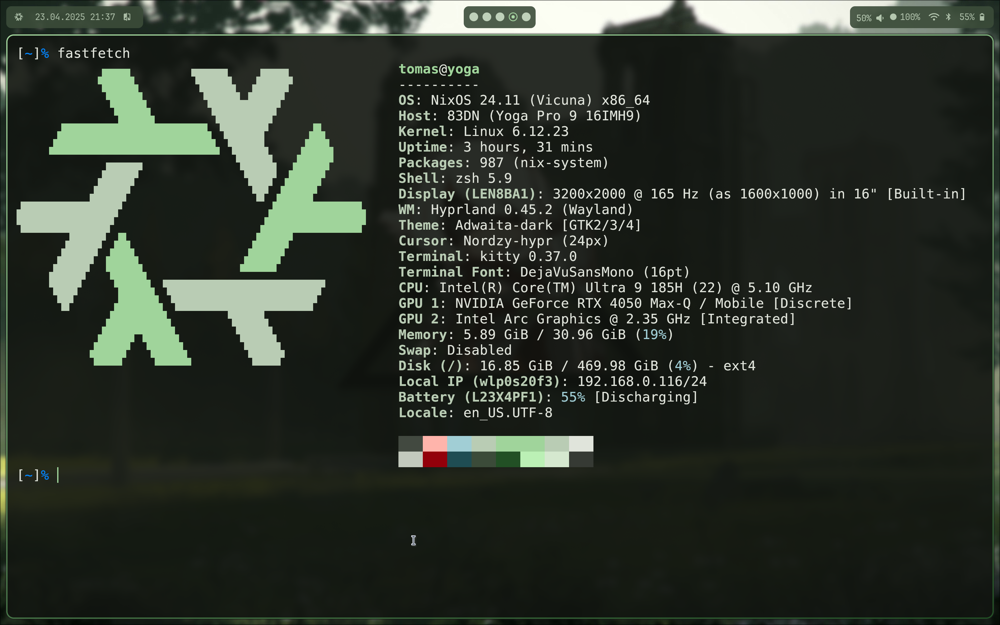

# ❄️ Zloutek1's NixOS & Home-Manager Configuration

Minimal. Modern. Personal.



# Hosts

## **Lenovo Yoga Pro 9 16IMH9**

- **CPU:** Intel Core i9-13905H (14-core)
- **GPU:** NVIDIA GeForce RTX 4050 (dGPU) + Intel Iris Xe (iGPU)
- **Display:** 3.2K 165Hz IPS (4096x2560)
- **WM:** Hyprland (Wayland)
- **DE:** None (minimal)
- **Boot:** GRUB
- **Usage:** Primary workstation for dev, writing, and experiments

## **Mac mini M1** (`mac-mini`, nix-darwin)

- **OS:** macOS 27, headless; FileVault with pre-boot SSH unlock
- **Role:** home server plumbing only: the `homelab` VM, the T7 mount, a
  watchdog, the backup repo (append-only rest-server) and the operator's commands

## **homelab** (NixOS guest on the Mac mini)

- **VM:** Lima VZ, 10 GiB RAM, 4 CPUs, 80 GiB disk; the T7 shared in at `/mnt/t7`
- **Runs:** every service as a NixOS module, in groups (`photos`: Immich; `edge`:
  Tailscale and Caddy), reachable only over the tailnet
- **Operating it:** [docs/homelab/operator.md](docs/homelab/operator.md)


# Users

### tomas
- **Shell:** `zsh`
- **Editor:** `neovim`
- **Terminal:** `kitty`
- **Theme:** Dynamic (from wallpaper with `matguen`)
- **Fonts:** JetBrainsMono Nerd Font
- **Browser:** Chromium
- **Bar:** `watbar`
- **Launcher:** `rofi`

# Features

- Declarative NixOS configuration using flakes
- Home Manager integration with modular setup
- Hyprland on Wayland with dynamic theming
- Dynamic theming based on wallpaper using Matugen
- Hardware Optimizations for Lenovo Yoga 16IMH9

## Structure

```bash
.
├── flake.nix         # Entry point: inputs, and flake-parts wiring
├── hosts/            # One dir per machine: which modules it uses + facts only it has
├── modules/          # Reusable building blocks, no machine facts
│   ├── common/       # options both nix-darwin and NixOS have (the servers' Nix settings)
│   ├── darwin/       # nix-darwin system modules
│   ├── hardware/     # Hardware support (Lenovo Yoga 16IMH9)
│   ├── home-manager/ # User environment modules
│   └── nixos/        # NixOS system modules; services/ and groups/ for the homelab
├── users/            # Per-person account, identity and program choices
├── overlays/         # Changes to `pkgs` (pkgs.unstable, our own packages)
├── pkgs/             # Custom packages, added to `pkgs` by overlays/
├── docs/homelab/     # operator's guide and restore runbooks
├── tailscale/        # the tailnet policy, kept for the record
└── tests/            # `nix flake check` invariants per host; secrets/ stubs for CI
```

Secrets are sops-nix files in the private `zloutek1/nix-secrets` repo (the
`secrets` input). Without access to it, add
`--override-input secrets path:./tests/secrets` to any `nix` command.

## Testing

```bash
nix flake check --no-build   # evaluate every host and run the invariants (fast)
nix flake check              # also build the hosts this machine's platform can build
nix fmt -- $(git ls-files "*.nix")  # fix formatting before the formatting check complains
nix run nixpkgs#deadnix -- -e .     # remove unused arguments before the deadnix check complains
```

`tests/common.nix` holds what every host must do (no module warnings, GC on,
...) and each `tests/<host>.nix` lists things that host must keep doing (key-only SSH on
the mac-mini, never sleeping, ...); a change that breaks one fails the check.
CI (`.github/workflows/check.yml`) runs the eval-only check for every host and
builds the mac-mini on an Apple Silicon runner, on every push to main and every PR,
with the stub secrets.

## Theming

Wallpapers are managed with a custom `wallchange` script that integrates with [matguen](https://github.com/matguen/matguen) to generate a dynamic GTK and terminal color scheme on each wallpaper change.

Scripts available:
- `wallchange`: Switch to the previous/next/random wallpaper and update themes
- `pick-wallpaper`: Open a selector to choose a specific wallpaper
- `update-colors`: Regenerate theme colors from the current wallpaper

## Keyboard Shortcuts

The following are the shortucts used in my system. (Super is windows key)

| Keybind | Action |
|--------|--------|
| <kbd>Super</kbd> + <kbd>Return</kbd> | Launch terminal (`kitty`) |
| <kbd>Super</kbd> + <kbd>F2</kbd> | Launch browser (`chromium`) |
| <kbd>Super</kbd> + <kbd>Shift</kbd> + <kbd>Q</kbd> | Close focused window |
| <kbd>Super</kbd> + <kbd>D</kbd> | Show app launcher (`rofi`) |
| <kbd>Super</kbd> + <kbd>E</kbd> | Launch file manager (`nautilus`) |
| <kbd>Super</kbd> + <kbd>Space</kbd> | Switch keyboard layout |
| <kbd>Print</kbd> | Screenshot (full) via `hyprshot` |
| <kbd>Super</kbd> + <kbd>Print</kbd> | Screenshot (area) via `hyprshot` |
| <kbd>Super</kbd> + <kbd>F</kbd> | Toggle fullscreen |
| <kbd>Super</kbd> + <kbd>[1-9]</kbd> | Switch workspace |
| <kbd>Super</kbd> + <kbd>Shift</kbd> + <kbd>[1-9]</kbd> | Move window to workspace |

## 🙏 Acknowledgments

- [NixOS](https://nixos.org/) for the amazing Linux distribution
- [Home Manager](https://github.com/nix-community/home-manager) for user environment management
- [Hyprland](https://hyprland.org/) for the excellent Wayland compositor
- [JaKooLit Hyprland Dots](https://github.com/JaKooLit/Hyprland-Dots/releases) for wallpaper select rofi theme
- [Adi1090x Rofi Dots](https://github.com/adi1090x/rofi) for Rofi launcher theme
- [maximmaxim345's Scripts](https://github.com/maximmaxim345/yoga_pro_9i_gen9_linux) for Lenovo Yoga 9i linux fixes
- [alyraffauf's Nix Dots](https://github.com/alyraffauf/nixcfg/tree/master) for Lenovo Yoga 9i fixes.
- [Nix Discourse: Nvidia dgpu prime offload mode + amd igpu + wayland?](https://discourse.nixos.org/t/nvidia-dgpu-prime-offload-mode-amd-igpu-wayland/63194/4)
- Various open-source project contributors that made this configuration possible